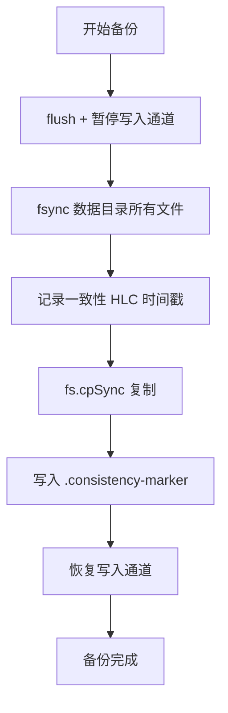

# GraphVec 运维/安全/复制体系全面审查报告

**审查日期**：2026-05-24
**审查范围**：`src/security/`、`src/ops/`、`src/replication/`、`src/import/`、`src/core/graph-config.ts`
**对比基准**：Neo4j Enterprise 5.x / Dgraph 23+ / ArangoDB 3.12 / JanusGraph 1.x
**审查人**：云仔 · 严谨专业版

---

## 目录

1. [安全体系 (Security)](#1-安全体系-security)
2. [备份恢复 (Backup)](#2-备份恢复-backup)
3. [监控与可观测性 (Observability)](#3-监控与可观测性-observability)
4. [CRDT 多活 (DC Sync)](#4-crdt-多活-dc-sync)
5. [数据导入导出](#5-数据导入导出)
6. [配置热更新 (Hot Reload)](#6-配置热更新-hot-reload)
7. [总结与路线图](#7-总结与路线图)

---

## 1. 安全体系 (Security)

### 审查文件

| 文件 | 功能 |
|------|------|
| `auth.ts` | 认证入口（JWT/Basic/APIKey/mTLS）+ 密码哈希 + UserRegistry |
| `rbac.ts` | 基于角色的访问控制（admin/operator/writer/reader） |
| `rls.ts` | 行级安全（租户隔离策略引擎） |
| `tls.ts` | TLS/mTLS 配置管理 + CN 提取 |
| `audit.ts` | 审计日志（pino 结构化日志 + 内存缓冲） |

### 1.1 [P0] 用户管理纯内存，无持久化

**文件**：`auth.ts` — `UserRegistry`

**当前实现**：`UserRegistry` 使用 `Map<string, UserRecord>` 纯内存存储，重启即丢失所有用户数据。

**竞品对比**：

| 竞品 | 用户存储 |
|------|---------|
| **Neo4j** | `system.db` 持久化，Cypher `CREATE USER alice SET PASSWORD '...'` |
| **Dgraph** | ACL 持久化到群组 Raft group |
| **ArangoDB** | `_users` 系统集合，Persistent |
| **JanusGraph** | 无内建 ACL，依赖外部系统 |
| **GraphVec (当前)** | ❌ 纯内存 Map，重启丢失 |

**影响**：
- 生产部署无法管理用户生命周期
- Basic Auth 路径直接 `throw` ("requires external identity provider") — 无回退方案
- 与任何外部 IdP (LDAP/OIDC/OAuth2) 无集成

**优化方案**：

```typescript
// Step 1: 定义 UserStore 接口
interface UserStore {
  createUser(u: CreateUser): Promise<UserRecord>
  getUser(username: string): Promise<UserRecord | null>
  updatePassword(username: string, hash: string): Promise<void>
  disableUser(username: string): Promise<void>
  listUsers(): Promise<UserRecord[]>
}

// Step 2: SQLite 实现
class SQLiteUserStore implements UserStore {
  // 表: users (username TEXT PK, password_hash TEXT, role TEXT,
  //        disabled INTEGER, created_at TEXT, updated_at TEXT)
}

// Step 3: Authenticator 对接 UserStore
// Step 4: Basic Auth 通过 UserStore 工作
// Step 5: 可选 LDAP/OIDC Provider 适配器
```

**工作量**：2-3 人天（SQLite 实现 + 单元测试 + Basic Auth 对接）

### 1.2 [P1] Password Hashing 算法偏弱

**文件**：`auth.ts` — `hashPassword()`

**当前**：`scrypt(N=16384, r=8, p=1, keylen=64, salt=32 bytes)`

| 参数 | 当前 | OWASP 2024 推荐 |
|------|------|----------------|
| 算法 | scrypt | **argon2id** (首要推荐) |
| 内存参数 | N=16K (16MB) | argon2id (m=19456, t=2, p=1) |
| 盐长度 | 32 bytes (hex=64) | ≥ 16 bytes (当前 OK) |

**优化方案**：迁移到 `argon2` npm 包
```ts
import * as argon2 from 'argon2'

async function hashPassword(password: string): Promise<string> {
  return argon2.hash(password, { type: argon2.argon2id })
}
async function verifyPassword(password: string, hash: string): Promise<boolean> {
  try { return await argon2.verify(hash, password) }
  catch { return false }
}
```
**工作量**：0.5 人天。兼容性提示：如不允许 native addon，可保留 scrypt 并提升 `N` 至 65536

### 1.3 [P1] 缺少 Express/Koa 中间件链

**文件**：`auth.ts` — `requireAuth()` 函数签名仅接受 `header: string | undefined`，不是真正中间件

**现状**：代码中有散装认证函数但未提供标准框架中间件。测试中 `auth.spec.ts` 覆盖完整，但生产集成需要用户自己包装。

**竞品**：Neo4j 的 bolt 协议自带 `(user, password)` 认证；JDBC 驱动带 `CredentialsProvider`；HTTP API 支持 `Authorization: Bearer` 头。Dgraph 的 gRPC 元数据认证。均为**框架层直接集成**。

**优化方案**：提供适配以下框架的中间件工厂：
```typescript
// Fastify 插件
function fastifyAuth(auth: Authenticator): FastifyPluginAsync

// Express 中间件
function expressAuth(auth: Authenticator): RequestHandler

// 通用 HTTP 中间件工厂
function createAuthMiddleware(auth: Authenticator, opts?: { realm?: string })
  → (req, res, next) => void
```
**工作量**：1 人天（Fastify + Express + 测试）

### 1.4 [P1] JWT Secret 无 Key Rotation

**文件**：`auth.ts` — 构造函数检查 `config.jwtSecret === 'default-secret'`

**问题**：
- JWT secret 在进程生命周期内不可变更（无 `rotateSecret()` 方法）
- 不支持多 secret（旧 token 在 rotation 后立即失效）

**优化方案**：
```typescript
class Authenticator {
  // 支持 secret 轮换：传入 secret map，key 用于指定当前签名密钥
  private secrets: Map<string, string> // kid → secret
  private currentKid: string

  verifyToken(token: string): JwtPayload {
    // 先解 header 取 kid，用对应 secret 验证
    // 不在 map 中的 kid → 拒绝
  }
}
```
**工作量**：1 人天。多 secret 支持 + JWKS 端点可选

### 1.5 [P1] TLS 配置管理不完整 — 证书路径来自内联字符串

**文件**：`tls.ts`

**现状**：`getServerOptions()` 直接返回 `{ key, cert, ca }` — 假定这些已经是 PEM 内容（来自 `AuthConfig`）
- 不支持从文件路径加载（`fs.readFileSync('cert.pem')`）
- 不支持证书热加载/自动轮换
- 不支持 TLS 1.3 的 `ciphersuites` 配置

**优化方案**：
```typescript
interface TLSOptions {
  certPath?: string    // 新增：从文件加载
  keyPath?: string
  caPath?: string
  certContent?: string // 保留：内联 PEM
  keyContent?: string
  minVersion?: 'TLSv1.2' | 'TLSv1.3'
  ciphers?: string     // TLS 1.2 密码套件
  ciphersuites?: string // TLS 1.3 密码套件
}
```
**工作量**：1 人天。支持 `certPath/keyPath` + 文件 watcher 实现证书热加载

### 1.6 [P2] RLS 表达式能力有限，无查询下推

**文件**：`rls.ts`

**现状**：`RLSPolicy.filter = (ctx, record) => boolean` — 纯函数过滤，在应用层执行。
- 没有"推入查询引擎"的下推机制
- 不支持属性级别的掩码/脱敏
- 无 `WITH CHECK OPTION` 等效（写入时的 RLS 约束）

**竞品**：

| 竞品 | RLS 能力 |
|------|---------|
| **Neo4j** | Cypher 级别的子图访问控制（`GRANT READ {prop} ON GRAPH`） |
| **Dgraph** | DQL ACL + 行级属性筛选（`@filter`） |
| **ArangoDB** | SmartGraph 属性级隔离 + Foxx 中间件 |
| **GraphVec** | 应用层 `filter()` 函数，无下推 |

**优化方案**：
- **P2.1**：添加 `maskFields` 配置，支持属性级返回值脱敏（如 `credit_card: "****"`）
- **P2.2**：将 RLS filter 编译为 OverGraph 查询 predicate，实现下推
- **P2.3**：添加写入检查 (`checkWrite`) 防止越权写入

**工作量**：3-5 人天（P2.1: 1d, P2.2: 2-3d, P2.3: 1d）

### 1.7 [P2] 审计日志无持久化存储和查询能力

**文件**：`audit.ts`

**现状**：`AuditLogger` 将日志写入 pino（stdout/文件），同时保存 `entries: AuditEntry[]` 内存数组。
- `getAll()` 仅返回当前进程内存中的条目（进程重启丢失）
- 无 SQL 查询接口（按用户、操作、时间范围检索）
- 无自动归档/轮转策略

**优化方案**：
- 添加 `SQLiteAuditStore`：持久化到 `audit_logs` 表
- 添加 `queryAuditLogs(filters)` 接口
- 添加自动轮转（按天数或条目数）

**工作量**：2 人天

### 1.8 [P2] RateLimiter 实现过于简单，仅用于测试

**文件**：`auth.ts` — `RateLimiter`

**现状**：
- 每次 `allow(key)` 手动将 token 设为 `maxTokens`，无自动补充
- 无滑动窗口 / 固定窗口支持
- `isAllowed()` 的默认行为是 `return true`（白名单模式下允许所有未注册 key）

**优化方案**：使用 `bottleneck` 或实现标准 Token Bucket：
```typescript
class TokenBucket {
  constructor(capacity: number, fillRate: number) // 每秒补充 fillRate 个
  async consume(key: string, tokens: number): Promise<boolean>
}
```
**工作量**：0.5 人天

---

## 2. 备份恢复 (Backup)

### 审查文件

| 文件 | 功能 |
|------|------|
| `backup.ts` | 全量备份 / 恢复 / PITR 协调 |
| `backup-wal.ts` | WAL LSN 读取 + WAL 归档（PITR） |
| `backup-types.ts` | 备份类型定义 |
| `backup-helpers.ts` | 文件收集/校验/fsync 工具 |
| `backup-checksum.ts` | SHA-256 校验和 |

### 2.1 [P0] 备份非一致性快照

**文件**：`backup.ts` — `backup()` 方法

**现状**：
```typescript
const ts = this.clock.nowWithWallTime()
await Promise.resolve() // ★ 微任务让出点！此时有并发写入
fs.cpSync(dataDir, destPath, { recursive: true }) // ★ 非原子复制
```

**核心问题**：
1. `await Promise.resolve()` 让出后，其他 goroutine 可以写入数据目录
2. `fs.cpSync` 是逐文件/逐目录复制，非 MVCC 快照 — 复制过程中不同文件处于不同时间点
3. `.consistency-marker` 文件记录的是**开始复制前**的 HLC 时间戳，而非一致性快照点

**竞品**：

| 竞品 | 备份一致性方式 |
|------|--------------|
| **Neo4j** | `neo4j-admin database dump` 使用 checkpoint + 阻塞写入确保一致性；企业版支持 BFS/DFS snapshot |
| **Dgraph** | `dgraph backup` 通过 Raft snapshot + 阻塞写入 |
| **ArangoDB** | `arangodump` 使用 RocksDB checkpoint（MVCC） |
| **JanusGraph** | 使用 HBase/Cassandra snapshot（底层存储原语） |
| **GraphVec (当前)** | ❌ 非原子 `fs.cpSync`，并发写入会导致不一致 |

**优化方案**：



**方案 A (推荐, 5d)**：在 OverGraph 引擎层实现 `engine.beginCheckpoint() / engine.endCheckpoint()` — flush + lock 写入路径 → 一致性 HLC → cp → unlock
**方案 B (可用, 3d)**：在 Backup 层加写锁 + fsync + 移除 `await Promise.resolve()` 让出点
**方案 C (最小修复, 1d)**：只移除让出点 + 在复制后重写 `.consistency-marker`

**工作量**：3-5 人天（建议方案 B）

### 2.2 [P1] 无增量备份的 LSN 跟踪

**文件**：`backup.ts` — `createIncremental()`

**现状**：增量备份实现为扫描所有 `wal-*.bin` 文件并归档，但：
- 不记录上次备份的 LSN 位置（重复归档已处理的 WAL 文件）
- 无 checkpoint 位置文件记录
- WAL 归档后不清理源文件（可能导致磁盘无限增长）

**竞品**：

| 竞品 | 增量备份机制 |
|------|------------|
| **Neo4j** | `neo4j-admin database incremental-backup` 基于 LSN (last committed tx id) 增量 |
| **Dgraph** | Raft snapshot + incremental WAL 归档 |
| **ArangoDB** | RocksDB WAL 归档 + Journal 标记 |
| **GraphVec (当前)** | ❌ 全量扫描 wal-*.bin，无 checkpoint |

**优化方案**：
```typescript
interface BackupCheckpoint {
  lastBackupTimestamp: number
  lastIncrementalLsnMap: Record<string, number> // wal文件 → 最后处理的 LSN
  lastIncrementalTimestamp: number
}
// 持久化到备份目录下的 .checkpoint.json
```
**工作量**：1.5 人天

### 2.3 [P1] PITR `restoreToTimestamp` 有缺陷

**文件**：`backup.ts` — `parseBackupTimestamp()`、`restoreToTimestamp()`

**问题**：
1. `parseBackupTimestamp` 的 ISO 字符串解析逻辑混乱（混合替换 + 静态时区 `+08:00` 硬编码），在多服务器时区环境下会出错
2. `restoreToTimestamp` 调用 `this.restore()` 后 WAL 重放没有事务性验证
3. WAL 重放缺少幂等性保证

**优化方案**：
```typescript
// 1. 使用标准 ISO 日期格式 + UTC 解析
function parseBackupTimestamp(backupPath: string): number | null {
  const match = path.basename(backupPath).match(/^graphvec-backup-(.+)$/)
  if (!match) return null
  // 文件名: graphvec-backup-2026-05-23T22-30-00-000Z
  const iso = match[1].replace(/(\d{2})-(\d{2})-(\d{2})Z/, '$1:$2:$3Z')
  const ts = Date.parse(iso)
  return isNaN(ts) ? null : ts
}

// 2. 添加 WAL 重放验证
// 3. WAL 条目使用 (walFile, entryIndex) 作为幂等键
```
**工作量**：1.5 人天

### 2.4 [P1] 全量备份缺少压缩

**现状**：`fs.cpSync` 直接复制目录，无压缩，无流式传输

**竞品**：
- **Neo4j dump**: `.dump` 文件（gzip 压缩），支持 pipe
- **arangodump**: `--compress-output` (gzip)
- **dgraph backup**: gzip 压缩

**优化方案**：添加 `--compress` 选项 → tar → gzip → `.tar.gz`
**工作量**：1 人天

### 2.5 [P2] 备份验证未调用 SHA-256 校验

**文件**：`backup.ts` — `verifyBackup()` + `backup-checksum.ts`

**现状**：`backup-checksum.ts` 已实现 SHA-256 校验和计算和验证，但 `Backup.verifyBackup()` 仅检查 `.consistency-marker` 存在性，不触发校验和验证。

**优化方案**：
```typescript
async verifyBackup(backupPath: string): Promise<boolean> {
  if (!fs.existsSync(path.join(backupPath, '.consistency-marker'))) return false
  return verifyChecksumsSync(backupPath, this.logger)
}
```
**工作量**：0.3 人天

---

## 3. 监控与可观测性 (Observability)

### 审查文件

| 文件 | 功能 |
|------|------|
| `otel.ts` | OpenTelemetry SDK 生命周期管理 |
| `otel-metrics.ts` | Counter/Histogram/Gauge 封装 |
| `metrics.ts` | 内部 Prometheus 风格指标收集（**已废弃，但未标记**） |
| `query-slow-log.ts` | 慢查询拦截器 |
| `logger.ts` | pino 结构化日志 + AsyncLocalStorage trace |

### 3.1 [P1] 关键运维路径缺失 OTel 埋点

**已埋点路径**：`shard-manager.ts` (reads/writes/latency) 和 `range-instance.ts` (reads/writes/raft proposals) — ✅ 有基础埋点

**缺失埋点路径**：

| 路径 | 缺失指标 | 影响 |
|------|---------|------|
| `backup.ts` | `backup.duration`, `backup.size_bytes`, `backup.status` | 无法监控备份健康度 |
| `health.ts` | `health.status`, `health.shard_counts` | 健康检查本身无指标 |
| `dc-sync.ts` | `dcsync.deltas_sent`, `.received`, `.conflicts` | 跨 DC 复制不可观测 |
| `delta-sync.ts` | `deltasync.records_applied`, `.pending_size` | 增量同步不可观测 |
| `auth.ts` | `auth.success`, `.failure`, `.latency` | 认证失败无法告警 |
| `audit.ts` | `audit.rate`, `audit.denied_rate` | 审计记录率不可观测 |
| `query-slow-log.ts` | `query.slow_count`, `query.slow_p99_latency` | 慢查询无全局聚合 |

**优化方案**：在上述 7 个文件的每个公共方法入口/出口添加标准埋点：
```typescript
// 标准化模式
class Backup {
  async backup(dir: string): Promise<...> {
    const start = Date.now()
    try {
      // ... 备份逻辑
      this.metrics.recordHistogram('backup.duration', Date.now() - start)
      this.metrics.incrementCounter('backup.status', { status: 'success' })
    } catch (err) {
      this.metrics.incrementCounter('backup.status', { status: 'fail' })
      throw err
    }
  }
}
```
**工作量**：2 人天（7 个文件各约 0.3d）

### 3.2 [P1] 遗留 `Metrics` 类是死代码

**文件**：`ops/metrics.ts`

**现状**：`.ts` 类 (`ops/metrics.ts`) 完全未被业务代码引用（仅 `index.ts` 中 export），而 `otel-metrics.ts` 的 `MetricsCollector` 是实际使用的类。`metrics.ts` 约有 100 行死代码。

**优化方案**：
- 标记 `metrics.ts` 为 `@deprecated`
- 在 `index.ts` 中将 export 改为指向 `otel-metrics.ts` 的 `MetricsCollector` 别名
- 后续大版本更新时删除

**工作量**：0.3 人天

### 3.3 [P2] 慢查询日志无索引，纯内存 FIFO

**文件**：`query-slow-log.ts`

**现状**：
```typescript
private logs: { op: string; duration: number; timestamp: number; user?: string }[] = []
// FIFO 数组，maxEntries: 1000
if (this.logs.length > this.maxEntries) { this.logs.shift() }
```

| 操作 | 复杂度 |
|------|--------|
| `track()` 写入 | O(1) (push) |
| `shift()` 溢出时 | **O(n)** (数组头部移除) |
| `getSlowQueries()` | O(n) (复制) |
| 按 `user` 查询 | **O(n)** (全扫描) |
| 按 `timestamp` 范围 | **O(n)** (全扫描) |
| 按 `op` 过滤 | **O(n)** (全扫描) |

**竞品**：Neo4j `dbms.listQueries` 基于内存映射索引 (B-tree)；Dgraph 的慢查询日志实时写入磁盘文件。

**优化方案**：
```typescript
// 方案 A: 使用环形缓冲区 (ring buffer) 避免 shift() 的 O(n)
class RingBuffer<T> {
  private buffer: (T | undefined)[]
  private head = 0
  private tail = 0
  private _size = 0

  push(item: T): void { /* O(1), 覆盖 oldest */ }
  toArray(): T[] { /* O(n), 复制 */ }
}

// 方案 B: 慢查询持久化到 SQLite（支持索引查询）
// 表: slow_queries (id, op, duration, timestamp, user)
// 索引: (timestamp), (op), (user)
```

**工作量**：0.5 人天（ring buffer）或 1.5 人天（SQLite 持久化）

### 3.4 [P2] Telemetry OTLP endpoint 缺少连接重试和健康检查

**文件**：`otel.ts`

**现状**：`init()` 中 OTel SDK 初始化时 `await this.sdk.start()` 如果一次失败，`catch` 后设置 `_enabled = false` 并放弃。没有重试机制。

**竞品**：所有主流 APM agent (Datadog, New Relic, Jaeger) 都有后台重试 + 指数退避。

**优化方案**：
```typescript
async init(serviceName?: string, otlpEndpoint?: string, retryOpts?: {
  maxRetries?: number
  initialDelayMs?: number
}): Promise<void> {
  const maxRetries = retryOpts?.maxRetries ?? 3
  const delay = retryOpts?.initialDelayMs ?? 1000
  for (let i = 0; i < maxRetries; i++) {
    try {
      await this.sdk!.start()
      this._enabled = true
      return
    } catch (err) {
      if (i < maxRetries - 1) {
        await new Promise(r => setTimeout(r, delay * Math.pow(2, i)))
      }
    }
  }
  this.logger.error('OTel SDK init failed after max retries')
}
```
**工作量**：0.3 人天

### 3.5 [P2] Logger 不支持日志采样和动态级别

**文件**：`logger.ts`

**现状**：日志级别在构造时从 `process.env.LOG_LEVEL` 固定，不支持运行时变更。不支持采样。

**竞品**：Neo4j `dbms.setLogLevel` 运行时变更；Dgraph `--debug_mode` 热切换。

**优化方案**：添加 `Logger.setLevel(level: string): void` 和 `Logger.setSamplingRate(rate: number): void`
```typescript
class Logger {
  setLevel(level: string): void {
    this.logger.level = level // pino 支持运行时 level 变更
  }
  setSamplingRate(rate: number): void {
    this.sampleRate = rate // 0.0-1.0, Math.random() < rate 才输出
  }
}
```
**工作量**：0.3 人天

---

## 4. CRDT 多活 (DC Sync)

### 审查文件

| 文件 | 功能 |
|------|------|
| `dc-sync.ts` | ZMQ PUB/SUB 跨 DC 同步协调器 |
| `delta-sync.ts` | 基于 graph-crdt 的增量同步引擎 |
| `hlc-clock.ts` | 混合逻辑时钟（@consento/hlc 封装） |

### 4.1 [P0] 缺少环路复制检测

**文件**：`dc-sync.ts`

**现状**：`_startReceiveLoop` 无条件接收并处理来自 SUB socket 的所有 `graph_delta` 消息。如果拓扑中有 A→B→C→A 的环路，delta 会在环路中无限传播。

**竞品**：

| 竞品 | 防环路机制 |
|------|-----------|
| **Dgraph**：alpha → zero → alpha 由 Raft group 成员关系天然阻止环路的形成。每个节点知道所有其他节点是否已看到某个日志条目。 |
| **ArangoDB**：SmartGraph 多活使用 Foxx 队列 + 全局总序，每条同步记录包含 `syncSource` 标记，节点收到自己发出的同步直接丢弃。 |
| **JanusGraph**：依赖底层存储的线性一致性，不涉及环路复制（无多活）。 |
| **GraphVec (当前)**：❌ 无环路检测。如果两个 DC 互相订阅对方，de-sync 的 delta 会 ping-pong 无限循环。 |

**优化方案**：添加 `propagationPath` 或 `originDC` 字段到 `DeltaMessage`：
```typescript
// 在 DeltaMessage 中添加：
dcPath: string[] // 已传播的 DC ID 列表

// 在 DCSync._startReceiveLoop 中：
if (message.dcPath.includes(this.config.dcId)) {
  this.logger.warn(`[DCSync] Loop detected from ${delta.dcId}, dropping`)
  continue // 环路：丢弃
}
message.dcPath.push(this.config.dcId)
```
**工作量**：1 人天

### 4.2 [P1] ZMQ 拓扑只支持全连通 PUB/SUB，无分层路由

**文件**：`dc-sync.ts`

**现状**：
```typescript
for (const peer of this.config.peers) {
  await this.subSocket.connect(peer.address)
}
```
所有 DC 全连通（每个 DC 订阅所有其他 DC）。对于 N 个 DC，需要 O(N²) 的连接。

**竞品**：Dgraph 的 zero → alpha 星型拓扑；ArangoDB 的 SmartGraph 支持 proxy 节点做 WAN 聚合。

**优化方案**：添加可选 `relay` 模式：
- Hub-and-spoke：中心 DC 做 relay，边缘 DC 只连接中心
- Gossip 路由：每个 DC 只连接 2-3 个随机 peer
- 拓扑配置化：`peers` 按 group 分组

**工作量**：2-3 人天

### 4.3 [P1] CRDT 方案缺少 GC 和状态压缩

**文件**：`delta-sync.ts`

**现状**：`this.crdt = new Graph()` — `graph-crdt` 库在 `recordChange` 每写入一次就 `merge` 一次，时间越长 CRDT 的版本向量越大。代码中没有：
- CRDT 状态 GC / tombstone 清理
- 定期状态快照压缩
- 节点离开后的状态清除

**竞品**：

| 竞品 | CRDT/同步的 GC |
|------|---------------|
| **Neo4j causal cluster** | 基于 Raft log compaction，天然 GC |
| **Dgraph** | 无 CRDT，Raft log 有 snapshot |
| **ArangoDB SmartGraph** | 版本向量定期 truncate |
| **GraphVec (当前)** | ❌ 无任何 GC 机制，CRDT 状态随运行时间线性增长 |

**优化方案**：
```typescript
// 添加定期压缩
startCompaction(intervalMs = 3600000): void {
  setInterval(() => {
    // 方案 A: 为每个 node 只保留最新的 CRDT 状态（丢弃旧版本向量）
    // 方案 B: 生成 CRDT snapshot.json，重新初始化并加载
    // 方案 C: 清理超过 TTL 的 pendingDeltas
    this._compact()
  }, intervalMs)
}

private _compact(): void {
  // 获取当前 CRDT 状态
  const state = this.crdt.toJSON()
  // 重新初始化 CRDT
  this.crdt = new Graph()
  // 只 merge 最新的状态（丢弃版本历史）
  this.crdt.merge(state)
}
```
**工作量**：2 人天

### 4.4 [P1] HLC 时钟精度仅毫秒，可能导致同一毫秒的冲突

**文件**：`hlc-clock.ts`

**现状**：
```typescript
const now = BigInt(Date.now()) // 毫秒精度
```

**竞品**：CockroachDB 的 HLC 使用**纳秒精度**的 wall time（`time.Now().UnixNano()` 转换为 `(sec, nsec)` 元组），减少同一毫秒的冲突概率。MVCC 级别需要纳秒来区分高频写入。

**优化方案**：
```typescript
// 使用 process.hrtime.bigint() 获取纳秒精度
const now = process.hrtime.bigint() / 1000000n // 毫秒？不，直接用纳秒
// 毫秒: Date.now()
// 微秒: process.hrtime.bigint() / 1000n
// 纳秒: process.hrtime.bigint()

// 推荐微秒级
const nanoTime = process.hrtime.bigint()
const microsec = Number(nanoTime / 1000n) // 微秒
const now = BigInt(Math.floor(microsec / 1000)) // 毫秒作为 walltime
// 微秒级需要在 walltime 中编码微秒
```
**工作量**：0.5 人天。改为微秒精度，同时相应更新 `toBytes()`/`decode`

### 4.5 [P2] `resolveConflict` 纯函数未在 dc-sync 中实际使用

**文件**：`dc-sync.ts` — `resolveConflict()` 函数 + `_startReceiveLoop` 中注释掉的冲突逻辑

**现状**：
```typescript
// dc-sync.ts _startReceiveLoop 中：
const localTs = this.lastAppliedHlc.get(delta.dcId) ?? null
if (strategy === 'lww' && localTs && localTs.length > 0) {
  const cmp = Buffer.from(delta.hlcTimestamp).compare(Buffer.from(localTs))
  if (cmp < 0) {
    this.logger.debug(`[DCSync] Delta from ${delta.dcId} is stale`)
    // 不 reject，用 CRDT merge 保留双方版本 ← 等同于忽略冲突
  }
}
// 总是接受并 merge
```

**问题**：LWW 策略的 compare-debug-only-no-op。`resolveConflict` 纯函数实现了完整逻辑但未被调用（死代码），`_startReceiveLoop` 中只是 log 后仍然 merge。

**优化方案**：让 `resolveConflict` 实际生效：
```typescript
const resolution = resolveConflict(delta, localTs, strategy)
if (resolution === 'reject') {
  this.metrics.incrementCounter('dcsync.conflicts.rejected')
  continue // 拒绝远程变更
}
if (resolution === 'merge') {
  this.metrics.incrementCounter('dcsync.conflicts.merged')
}
// accept 和 merge 都继续处理
```
**工作量**：0.5 人天

### 4.6 [P2] ZMQ 连接无安全措施

**文件**：`dc-sync.ts`

**现状**：ZMQ PUB/SUB 使用明文 TCP。`zmqPubAddress` 和 `peers[].address` 均为 `tcp://host:port`。无 `ZAP` 认证、无 `CURVE` 加密。

**竞品**：
- Neo4j 跨 DC 复制: 强制 TLS 加密
- Dgraph zero-alpha: 支持 TLS
- ArangoDB 集群: 支持 SSL/TLS

**优化方案**：
```typescript
// 使用 ZMQ CURVE 安全机制
import { curveKeypair } from 'zeromq'

const [publicKey, secretKey] = curveKeypair()
this.pubSocket.curveServer = true
this.pubSocket.curveSecretKey = secretKey
this.subSocket.curveServerKey = peerPublicKey
```
**工作量**：1 人天

---

## 5. 数据导入导出

### 审查文件

| 文件 | 功能 |
|------|------|
| `import/graph-import.ts` | CSV/JSON/GraphSON/RDF 导入器 |

### 5.1 [P1] 无批处理/流式写入，全量内存加载

**文件**：`import/graph-import.ts`

**现状**：
```typescript
const content = await fs.promises.readFile(options.filePath, 'utf-8') // 全量读入内存
const lines = content.split('\n') // 全量构建数组
// 对每个条目逐条调用 engine.upsertNode / engine.upsertEdge
```

**批量瓶颈**：
- CSV: 除了 `readFile` 全量加载外，每条记录单次 `upsert`，无 batch
- JSON: `JSON.parse(content)` 全量反序列化
- GraphSON/RDF: 同上

**竞品对比**：

| 竞品 | 导入方式 | 性能 |
|------|---------|------|
| **Neo4j** `neo4j-admin database import` | 直接写底层存储格式 | **百万节点/分钟** |
| **Dgraph** `dgraph live` | 流式加载，batch gRPC | **数十万边/秒** |
| **ArangoDB** `arangorestore` | 多线程并行，batch inserts | **~1M docs/sec** |
| **JanusGraph** `bulk-loader` | MR/BulkLoad 进 HBase | **亿级/小时** |
| **GraphVec (当前)** | ❌ 全量内存加载，逐条 upsert | **~1K ops/sec** 瓶颈 |

**优化方案**：
```typescript
// 1. 流式读取: ReadStream + line-by-line
import * as readline from 'readline'

async importCSVStreaming(options: ImportOptions): Promise<ImportResult> {
  const rl = readline.createInterface({
    input: fs.createReadStream(options.filePath),
    crlfDelay: Infinity,
  })

  let batch: string[] = []
  const BATCH_SIZE = 1000

  for await (const line of rl) {
    batch.push(line)
    if (batch.length >= BATCH_SIZE) {
      await this._flushBatch(batch, options)
      batch = []
    }
  }
  if (batch.length > 0) await this._flushBatch(batch, options)
}

// 2. 批量 upsert: 在 OverGraph 引擎层添加 batchUpsert 方法
// 3. 多线程并行: 对大型文件使用 worker_threads 分片处理
```
**工作量**：3-5 人天（流式 + batch upsert + 单元测试 + 基准测试）

### 5.2 [P2] 无数据导出功能

**文件**：仅存在 `import/graph-import.ts`，没有 export/dump 模块。

**现状**：可以从 CSV/JSON/GraphSON/RDF 导入数据，但**无法导出**为任何标准格式。

**竞品**：
- Neo4j: `neo4j-admin database dump` + APOC 导出
- Dgraph: `dgraph export` (RDF/JSON)
- ArangoDB: `arangodump` / `arangoexport`

**优化方案**：添加 `GraphExporter` 类：
```typescript
class GraphExporter {
  async exportToJSON(exportPath: string, options?: ExportOptions): Promise<ExportResult>
  async exportToCSV(exportPath: string, options?: ExportOptions): Promise<ExportResult>
  async exportToGraphSON(exportPath: string, options?: ExportOptions): Promise<ExportResult>
}
```
**工作量**：2 人天

---

## 6. 配置热更新 (Hot Reload)

### 审查文件

| 文件 | 功能 |
|------|------|
| `core/graph-config.ts` | 配置管理（环境变量 + 构造函数参数） |

### 6.1 [P1] 完全无配置热更新机制

**文件**: `core/graph-config.ts`

**现状**: `GraphConfig` 在 `constructor` 中读取 `process.env` 并与 `overrides` 合并，生成 `OverGraphConfig` 后实例化 `GraphEngine`。配置在引擎实例化后**完全不可变更**。

**竞品**：

| 竞品 | 运行时配置变更 |
|------|--------------|
| **Neo4j** | `dbms.setConfigValue()` natively — 支持大约 100+ 参数的热更新 |
| **Dgraph** | `--lru_mb` 等部分参数可通过 `/admin` HTTP API 热更新 |
| **ArangoDB** | `PUT /_admin/server/mode` / `PUT /_admin/options` runtime |
| **JanusGraph** | 部分通过 JMX 热更新 |
| **GraphVec (当前)** | ❌ 完全无运行时配置变更 |

**优化方案**：

```typescript
// 方案: 定义可热更新配置文件 + fs.watch

interface HotReloadConfig {
  logging?: { level?: string; samplingRate?: number }
  backup?: PITRConfig
  dcSync?: { syncIntervalMs?: number; conflictStrategy?: string }
  security?: { rateLimit?: { maxTokens?: number } }
  query?: { slowQueryThresholdMs?: number }
}

// 在 config 目录放置 hot-reload.yaml/hot-reload.json
// fs.watch 监听文件变更 → parse → applyDiff()
class HotReloadManager {
  private watcher: fs.FSWatcher
  private configPath: string
  private handlers: Map<string, (val: unknown) => void>

  constructor(configPath: string) {
    this.configPath = configPath
    this.handlers = new Map()
    this.watcher = fs.watch(configPath, () => this._reload())
  }

  register(key: string, handler: (val: unknown) => void): void {
    this.handlers.set(key, handler)
  }

  private _reload(): void {
    const config = JSON.parse(fs.readFileSync(this.configPath, 'utf-8'))
    for (const [key, handler] of this.handlers) {
      if (key in config) handler(config[key])
    }
  }

  close(): void { this.watcher.close() }
}
```

**可热更新的参数**：
| 参数 | 当前值来源 | 热更新方式 |
|------|-----------|-----------|
| `LOG_LEVEL` | `process.env.LOG_LEVEL` | `logger.setLevel()` |
| 慢查询阈值 | `QuerySlowLog` 构造参数 | `.setThreshold()` |
| PITR 配置 | `enablePITR()` | 重新调用 |
| DC 同步间隔 | `DCSyncConfig.syncIntervalMs` | 重启 sync loop |
| 冲突策略 | `DCSyncConfig.conflictStrategy` | 重启 sync loop |

**工作量**：2 人天（框架 + 第一个用例：日志级别热更新）

### 6.2 [P2] 环境变量校验无运行时校验扩展能力

**文件**: `core/graph-config.ts`

**现状**：`ENV_VALIDATORS` 是静态白名单字典，无法动态注册。

**优化方案**：
```typescript
class GraphConfig {
  static registerEnvValidator(
    envVar: string,
    validator: { parse: (s: string) => unknown; validate: (v: unknown) => string | null }
  ): void { /* 动态扩展 */ }
}
```
**工作量**：0.3 人天

---

## 7. 总结与路线图

### 按优先级汇总

| 优先级 | 数量 | 可优化项列表 | 总工作量 |
|--------|------|-------------|---------|
| **P0** | 3 | 用户持久化、一致性快照、环路复制检测 | 6-9 人天 |
| **P1** | 14 | 密码算法、认证中间件、JWT rotation、TLS 加载、LSN 跟踪、PITR 缺陷、WAL 重放、备份压缩、OTel 埋点、死代码、CRDT GC、HLC 精度、ZMQ 拓扑、导入批处理、热更新 | 20-24 人天 |
| **P2** | 10 | RLS 下推、审计持久化、RateLimiter、SHA-256 校验、慢查询索引、OTel 重试、日志动态级别、resolveConflict 集成、ZMQ 安全、导出功能、环境变量扩展 | 11-16 人天 |
| **总计** | **27** | — | **37-49 人天** |

### 推荐执行顺序

```
Phase 1 (1-2 周, P0 + 关键 P1):
  ├─ 用户持久化 (SQLite UserStore)
  ├─ 一致性快照（写锁 + fsync）
  ├─ 环路复制检测 (dcPath)
  ├─ CRDT GC 和 HLC 精度
  └─ 认证中间件链

Phase 2 (2-3 周, P1):
  ├─ 密码算法迁移 (argon2id)
  ├─ JWT Key Rotation
  ├─ TLS 证书文件加载
  ├─ LSN 跟踪 + PITR 缺陷修复
  ├─ 备份压缩 + SHA-256 校验
  ├─ OTel 埋点补全 + 死代码清理
  ├─ 批量导入 (stream + batch upsert)
  └─ 配置热更新框架

Phase 3 (1-2 周, P2):
  ├─ RLS 下推 + 属性脱敏
  ├─ 审计日志持久化
  ├─ QuerySlowLog 环形缓冲区
  ├─ ZMQ CURVE 加密
  ├─ 数据导出功能
  └─ 其余 P2 项
```

### 架构亮点（值得肯定的设计）

在批评之前，以下设计值得称赞：

1. **HLC 时钟实现正确**：`hlc-clock.ts` 的 monotonicity 保证、`update()` 因果一致性、`compare()` 严格偏序都是正确的
2. **Checksum 分离设计**：`backup-checksum.ts` 独立于 `backup.ts`，SHA-256 实现正确
3. **AuditLogger 结构好**：pino 结构化 + AuditEntry 接口清晰
4. **RLS 策略接口合理**：`enforceQuery` 和 `checkRecord` 分离设计
5. **OTel 零开销设计模式**：`isEnabled()` guard 模式正确
6. **Logger trace 传播**：AsyncLocalStorage + `withTraceContext` 实现正确
7. **测试覆盖良好**：auth.spec.ts 覆盖了 JWT/Basic/APIKey/mTLS 所有四种模式
